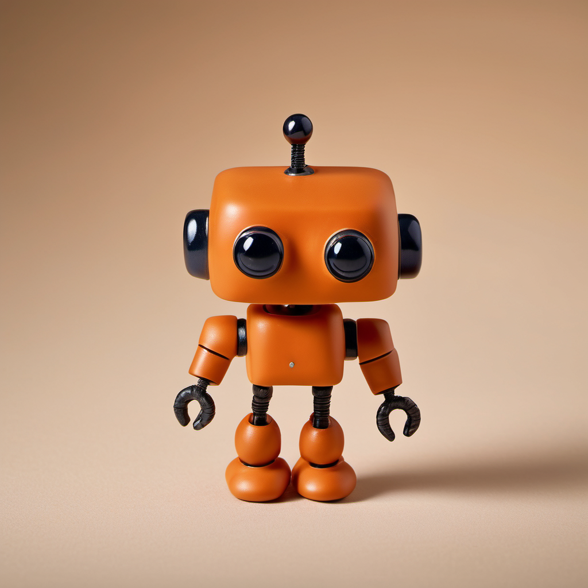

# Orange Robot example

An included MiniMax H3 RefMod you can try before making your own.

## Try it

1. Download [lorapilot_orange_robot_v1.safetensors](lorapilot_orange_robot_v1.safetensors)
   and put it in `ComfyUI/models/refmods/`.
2. Open [Orange-Robot-Demo.json](../../workflows/Orange-Robot-Demo.json) in ComfyUI.
3. Click **Refresh RefMods** in **CHARACTERS**, confirm slot 1 is
   `lorapilot_orange_robot_v1`, then Run.

The demo already includes a five-second scene and the correct `<Picture 1>` tag.
It needs the same H3 models and extensions as the main workflow. You do not need
to train anything or load the source PNG to use the finished RefMod.

On LoRA Pilot, the model folder is normally `/workspace/models/refmods/`.

## What is included

- `lorapilot_orange_robot_v1.safetensors`: 111,336 bytes, an image-kind RefMod
  containing one FP16 VAE latent with shape `[1, 24, 1, 48, 48]` (576 tokens).
- `reference.png`: the unchanged 1024 × 1024 source image.
- `create.api.json`: the ComfyUI API graph used to encode it.
- `manifest.json`: source information, settings and file hashes.
- `LICENSE`: the source artwork's MIT license and attribution.

The source is `ceramic_robot_00001_.png` from LoRA Pilot's eight-image
[orange robot dataset](https://github.com/vavo/lora-pilot/tree/main/apps/Portal/samples/orange-robot),
generated with ComfyUI and SDXL base 1.0. Those eight images depict different robot
designs. This example deliberately uses the clear front-facing robot with both
eyes, antenna, hands and feet visible, to provide one unambiguous reference.

The saved reference uses Full Reference mode at 768 pixels, with no pooling,
refinement or H3 weight training. The background is included; no subject mask
was applied. `pilotceramic`, the original LoRA dataset trigger word, is not needed
here: the demo addresses the encoded reference using `<Picture 1>`.

## Recreate it

With the supplied Character RefMod Creator, put only `reference.png` in a folder,
select that folder, set the name to `lorapilot_orange_robot_v1`, use Full Reference
at 768 pixels and Run. Reusing the same name replaces the existing file.

For the API graph, place the PNG at
`ComfyUI/input/refmod-pilot-orange-robot/reference.png`. Submit `create.api.json`
as the `prompt` field of a ComfyUI `/prompt` request. It requires the H3 video VAE
and ComfyUI-MiniMaxH3Mod; it does not run the video diffusion model.

## Validation

The file was created successfully on the LoRA Pilot pod and its safetensors
header, tensor dimensions and source image hash were checked. See the repository
[validation notes](../../VALIDATION.md) for loader and encoding checks.
No finished demo video or likeness guarantee is included.
